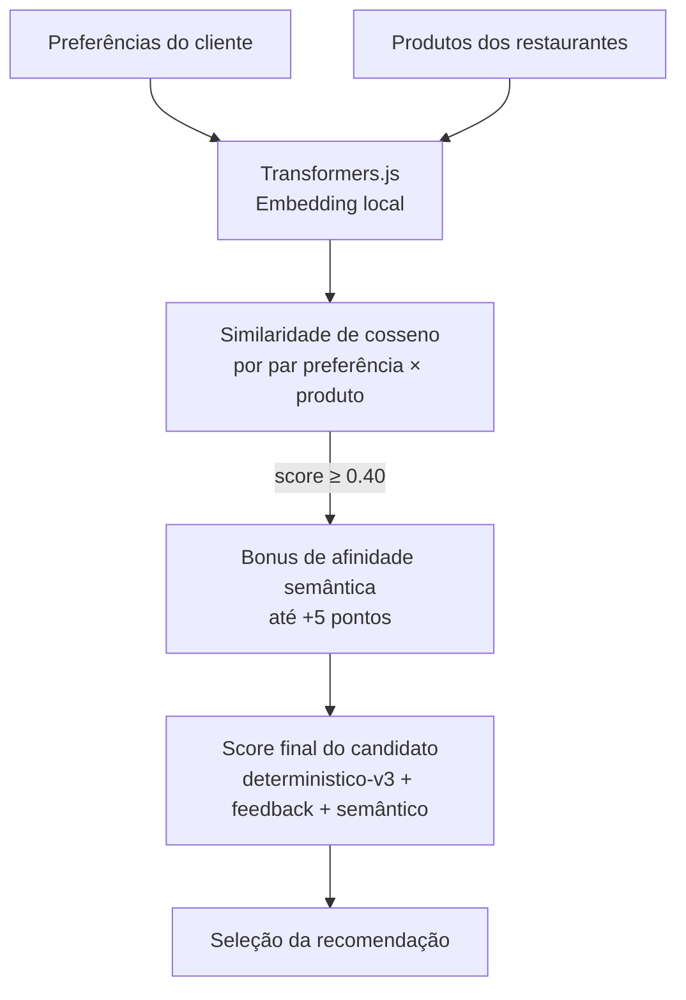
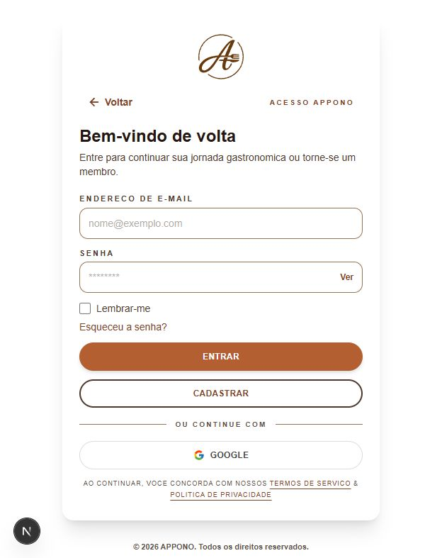
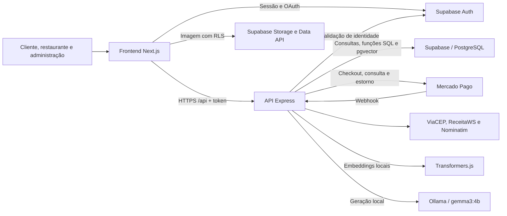

<p align="center">
  
</p>

# Appono

**Plataforma completa de reservas de mesas, pedidos antecipados e operação de restaurantes.**

[](frontend/package.json)
[](frontend/package.json)
[](backend/package.json)
[](backend/src/lib/supabase.js)

O Appono conecta o planejamento alimentar do cliente à rotina do restaurante: descobrir estabelecimentos, reservar mesas, antecipar pedidos e acompanhar o atendimento. O restaurante gerencia agenda, cardápio, cozinha e financeiro; a administração acompanha suporte e operações financeiras.

A plataforma está em produção com backend hospedado na Oracle Cloud (ARM, free tier) via HTTPS em `api.apponobr.com` e frontend na Vercel.

## Sumário

- [Funcionalidades](#funcionalidades)
- [Appono Rotina](#appono-rotina)
- [Appono Intelligence](#appono-intelligence)
- [Appono Intelligence — Base de Conhecimento (RAG)](#appono-intelligence--base-de-conhecimento-rag)
- [Interface](#interface)
- [Tecnologias e arquitetura](#tecnologias-e-arquitetura)
- [Estrutura do repositório](#estrutura-do-repositório)
- [Instalação](#instalação)
- [Variáveis de ambiente](#variáveis-de-ambiente)
- [Supabase e migrations](#supabase-e-migrations)
- [Execução local](#execução-local)
- [Deploy em produção (Oracle Cloud)](#deploy-em-produção-oracle-cloud)
- [Comandos e verificações](#comandos-e-verificações)
- [Solução de problemas](#solução-de-problemas)
- [Documentação complementar](#documentação-complementar)
- [Licença](#licença)

## Funcionalidades

| Área | Recursos | Detalhes |
| --- | --- | --- |
| Contas | Cadastro de cliente e restaurante, login, recuperação de senha e acesso com Google | Supabase Auth com perfis no banco e RLS |
| Descoberta | Busca, perfis públicos, cardápios, favoritos e avaliações | Geolocalização por coordenadas e consultas externas |
| Reservas e pedidos | Disponibilidade de mesas, preço da reserva, pedido antecipado, confirmação de presença e check-in | Funções SQL, controle de concorrência e regras operacionais |
| Restaurante | Gestão do cardápio, agenda, fila da cozinha, histórico e indicadores | Perfil autenticado com painel operacional completo |
| Pagamentos | Checkout Pro, conexão OAuth de restaurantes, webhook, financeiro e reembolso | Integração Mercado Pago com cifração AES-256-GCM |
| Atendimento | Chat entre participantes, notificações internas, chamados e análise administrativa | Suporte multicanal com validação de propriedade |
| Appono Rotina | Perfil alimentar, endereço geocodificado, janelas de refeição, planejamento semanal, Google Agenda, recomendações explicáveis, segurança alimentar e conversão em reserva/pedido | Motor de recomendação com inteligência artificial |
| Appono Intelligence — RAG | Matching semântico de preferências, base de conhecimento com busca híbrida (vetorial + lexical), geração de resposta com LLM local, isolamento por tenant | Embeddings locais com Transformers.js e geração com Ollama |

## Appono Rotina

O **Appono Rotina** transforma preferências alimentares e horários do dia em um planejamento semanal de refeições. O cliente informa restrições alimentares, alergias, endereço e janelas de refeição. Com esses dados, a plataforma gera sugestões de restaurantes explicáveis e compatíveis com a rotina, permitindo aprovar, trocar ou recusar cada sugestão. As escolhas aprovadas seguem para reserva de mesa ou pedido antecipado.

Cada planejamento é persistido por semana. O módulo prioriza a semana atual e, quando não existente, a próxima planejada. Geração e regeneração retroativas são bloqueadas no frontend, na API e no domínio.

No fluxo de reserva, iniciar o checkout cria uma reserva pendente e bloqueia a mesa temporariamente. Após o pagamento aprovado, a reserva é confirmada. A mesa volta a ser elegível quando a visita é concluída, a reserva é cancelada ou o cliente é marcado como não compareceu.

### Appono Intelligence

O planejamento utiliza o modelo `deterministico-v3` como base e a `appono-intelligence-v2.1` como camada de personalização. A inteligência ordena opções já consideradas elegíveis e seguras — restrições, alergias, agenda, funcionamento, orçamento e disponibilidade continuam sendo filtros obrigatórios — sem depender de provedor externo de IA.

Em `/cliente/configuracoes`, o cliente ativa ou revoga o uso de interações na personalização. O consentimento vem desativado por padrão. O painel `/admin/rotina-intelligence` exibe métricas e estado operacional sem expor sinais ou identidades.

## Appono Intelligence — Base de Conhecimento (RAG)

O Appono Intelligence combina recomendação determinística de restaurantes com uma **camada de compreensão semântica** baseada em RAG (Retrieval-Augmented Generation). A infraestrutura de embeddings e busca vetorial atua em dois pontos:

1. **Matching semântico de preferências** — durante a geração do planejamento, o sistema vetoriza as preferências do cliente e compara semanticamente com os produtos dos restaurantes candidatos. Uma preferência como "comida japonesa" combina com "sushi", "sashimi" e "tempura" sem correspondência textual exata.

2. **Base de conhecimento operacional** — documentos de políticas, FAQ e operações acessíveis por busca semântica híbrida (vetorial + lexical), com geração de resposta via LLM local.

### Integração com a recomendação



Produtos com similaridade semântica acima do threshold recebem o flag `combinaPreferenciaRAG` e um bônus proporcional ao score. A integração é resiliente: se o RAG falhar ou estiver desativado, o fluxo determinístico continua sem interrupção.

### Componentes

| Componente | Tecnologia | Função |
| --- | --- | --- |
| Embeddings | Transformers.js com `paraphrase-multilingual-MiniLM-L12-v2` (384 dimensões) | Vetorização local multilíngue |
| Armazenamento | pgvector no Supabase/PostgreSQL | Persistência de vetores com RLS por tenant |
| Busca | RPC híbrida (cosine similarity + full-text search) | Recuperação por relevância semântica e lexical |
| Geração | Ollama com `gemma3:4b` (3,4 GB, ~66 tokens/s) | Resposta em linguagem natural, local e gratuita |
| Segurança | RLS, filtro de escopo, sanitização | Zero vazamento cross-tenant confirmado |

### Modos de operação

- **SOMENTE_FONTES** — retorna os trechos relevantes com citações, sem gerar texto.
- **RESPOSTA** — gera uma resposta fundamentada nos documentos recuperados via LLM local.

### Avaliação de qualidade

Dataset de 95 perguntas em 7 categorias (respondíveis, sem evidência, transacionais, adversariais, cross-tenant, ambíguas).

| Métrica | Resultado | Critério |
| --- | --- | --- |
| Vazamentos cross-tenant | 0 | = 0 |
| Abstinência correta | 100% | ≥ 95% |
| Groundedness | 100% | ≥ 95% |
| Citações válidas | 100% | ≥ 98% |

### Segurança

- **Isolamento por tenant**: filtro de escopo aplicado em SQL antes da ordenação por relevância.
- **Kill switch**: `APPONO_RAG_ENABLED=false` desativa todo o RAG sem afetar o restante.
- **Testes adversariais**: 13 cenários cobrindo prompt injection, sanitização HTML, cross-tenant, limites de batch/dimensão, idempotência e kill switch.
- **Fallback resiliente**: falha no RAG não interrompe o fluxo de recomendação.

## Interface

<p align="center">
  
</p>

Outras referências visuais estão em [docs/figma-screenshots](docs/figma-screenshots).

## Tecnologias e arquitetura

| Camada | Tecnologias | Responsabilidade |
| --- | --- | --- |
| Interface | Next.js 16, React 19, Tailwind CSS 4 | Páginas, componentes e interação dos três perfis |
| API | Node.js, Express 5, JavaScript | Autorização, regras de negócio e integrações |
| Dados | Supabase/PostgreSQL, Auth, Storage e pgvector | Identidade, persistência, funções SQL, RLS e busca vetorial |
| Inteligência | Transformers.js, Ollama (`gemma3:4b`) | Embeddings locais multilíngues e geração de linguagem natural |
| Pagamentos | SDK Mercado Pago | Checkout Pro, consulta de pagamentos, OAuth e estornos |
| Infraestrutura | Docker, Caddy (reverse proxy + HTTPS), Oracle Cloud | Orquestração e deploy em produção |



As regras puras ficam em `backend/src/domain`; rotas coordenam HTTP, autorização e serviços. O frontend usa a API Express nos fluxos de negócio e o cliente Supabase para sessão e upload de imagens.

## Estrutura do repositório

```text
Appono/
├── .gitignore
├── .dockerignore
├── docker-compose.yml         # Orquestração backend + Ollama
├── package.json               # Workspaces e comandos conjuntos
├── package-lock.json
├── README.md
├── backend/
│   ├── .env.example           # Modelo de configuração da API
│   ├── package.json
│   ├── scripts/start.js       # Inicializa o Node com certificados TLS
│   ├── src/
│   │   ├── server.js          # Aplicação HTTP, CORS e rotas
│   │   ├── domain/            # Regras de reservas, pedidos, rotina e inteligência
│   │   ├── lib/supabase.js    # Clientes Supabase
│   │   ├── middleware/        # Autenticação, autorização e logs
│   │   ├── rag/               # Embedding, busca, geração e ingestão
│   │   ├── routes/            # Endpoints por módulo
│   │   └── services/          # Pagamentos, reservas, validações, geo e notificações
│   ├── evaluation/            # Dataset de avaliação do RAG
│   ├── reports/               # Relatórios de benchmark
│   ├── scripts/               # Seed, avaliação, benchmark e token admin
│   └── test/                  # Suíte node:test
├── frontend/
│   ├── .env.example           # Modelo de configuração pública
│   ├── package.json
│   ├── next.config.mjs
│   ├── app/                   # Rotas, layouts e metadados do Next.js
│   ├── components/            # Componentes de tela e controles
│   ├── lib/                   # API, sessão, tradução e hooks
│   └── public/brand/          # Logo e marca
├── supabase/migrations/       # Histórico SQL incremental
├── docs/                      # Guias técnicos e operacionais
└── scripts/                   # Manutenção e geração de documentação
```

## Instalação

### Pré-requisitos

- **Node.js 22 ou superior**
- **npm com suporte a workspaces**
- Acesso a um **projeto Supabase com o schema do Appono**
- Acesso HTTPS ao Supabase e, para pagamentos, ao Mercado Pago

```powershell
node --version
npm --version
npm ci
```

### Arquivos de configuração

```powershell
if (-not (Test-Path backend/.env)) {
    Copy-Item backend/.env.example backend/.env
}
if (-not (Test-Path frontend/.env.local)) {
    Copy-Item frontend/.env.example frontend/.env.local
}
```

Preencha os valores conforme a seção de variáveis de ambiente e conclua a [preparação do Supabase](docs/preparacao-supabase.md) antes de iniciar.

## Variáveis de ambiente

### Backend — `backend/.env`

```dotenv
PORT=3001
FRONTEND_ORIGIN=http://localhost:3000
SUPABASE_URL=https://seu-projeto.supabase.co
SUPABASE_PUBLISHABLE_KEY=sua-chave-publica
SUPABASE_SECRET_KEY=sua-chave-secreta-do-backend
SUPABASE_ALLOW_INSECURE_TLS=false
MERCADO_PAGO_MODO_REPASSE=SIMULADO
MERCADO_PAGO_PERMITIR_PRODUCAO=false
```

| Variável | Necessidade | Uso |
| --- | --- | --- |
| `SUPABASE_URL` | Obrigatória | URL do projeto Supabase |
| `SUPABASE_PUBLISHABLE_KEY` | Obrigatória | Autenticação e operações com o token do usuário |
| `SUPABASE_SECRET_KEY` | Obrigatória | Operações administrativas e suporte |
| `PORT` | Opcional; padrão `3001` | Porta da API |
| `FRONTEND_ORIGIN` | Padrão `http://localhost:3000` | CORS e callbacks |
| `FRONTEND_PUBLIC_URL` | Para checkout | URL HTTPS pública do frontend |
| `BACKEND_PUBLIC_URL` | Para integrações externas | URL HTTPS pública da API |
| `APPONO_ADMIN_EMAILS` | Para administração | E-mails autorizados, separados por vírgula |
| `MERCADO_PAGO_TEST_ACCESS_TOKEN` | Para checkout de teste | Token da conta de testes |
| `MERCADO_PAGO_ACCESS_TOKEN` | Conforme o modo financeiro | Token padrão |
| `MERCADO_PAGO_MODO_REPASSE` | Padrão `SIMULADO` | Seleciona o fluxo financeiro |
| `MERCADO_PAGO_PERMITIR_PRODUCAO` | Manter `false` em desenvolvimento | Controle de produção |
| `MERCADO_PAGO_APP_ID` e `CLIENT_SECRET` | Para OAuth do restaurante | Credenciais da aplicação |
| `MERCADO_PAGO_REDIRECT_URI` | Para OAuth do restaurante | Callback público |
| `MERCADO_PAGO_WEBHOOK_SECRET` | Para validar webhook | Obrigatório em produção |
| `APPONO_MERCADO_PAGO_TOKEN_ENCRYPTION_KEY` | Para OAuth | Chave AES-256-GCM de 32 bytes |
| `APPONO_CALENDAR_TOKEN_ENCRYPTION_KEY` | Para Google Agenda | Chave de cifração |
| `GOOGLE_CALENDAR_CLIENT_ID`, `CLIENT_SECRET`, `REDIRECT_URI` | Para Google Agenda | OAuth com callback |
| `APPONO_EMAIL_ENABLED` | Padrão `false` | Envio real de e-mails |
| `RESEND_API_KEY` e `RESEND_FROM_EMAIL` | Para envio Resend | Credenciais do provedor |

#### RAG — Base de Conhecimento

| Variável | Padrão | Uso |
| --- | --- | --- |
| `APPONO_RAG_ENABLED` | `false` | Kill switch principal do RAG |
| `APPONO_RAG_INTELLIGENCE_SUPPORT_ENABLED` | `false` | Suporte semântico nas recomendações |
| `APPONO_RAG_INGESTION_ENABLED` | `false` | Endpoints de ingestão |
| `APPONO_RAG_VECTOR_SEARCH_ENABLED` | `false` | Busca vetorial |
| `APPONO_RAG_HYBRID_SEARCH_ENABLED` | `false` | Busca híbrida |
| `APPONO_RAG_LLM_ENABLED` | `false` | Modo RESPOSTA com LLM |
| `APPONO_RAG_LLM_PROVIDER` | `ollama` | Provedor do LLM |
| `APPONO_RAG_LLM_BASE_URL` | `http://127.0.0.1:11434` | URL do Ollama |
| `APPONO_RAG_LLM_MODEL` | — | Modelo (ex: `gemma3:4b`) |
| `APPONO_RAG_MIN_SCORE` | `0.45` | Score mínimo de relevância |
| `APPONO_RAG_TOP_K` | `10` | Máximo de trechos retornados |

### Frontend — `frontend/.env.local`

```dotenv
NEXT_PUBLIC_API_URL=http://localhost:3001/api
NEXT_PUBLIC_SUPABASE_URL=https://seu-projeto.supabase.co
NEXT_PUBLIC_SUPABASE_PUBLISHABLE_KEY=sua-chave-publica
NEXT_PUBLIC_AUTH_CALLBACK_URL=http://localhost:3000/auth/callback
NEXT_PUBLIC_PASSWORD_RECOVERY_REDIRECT_URL=http://localhost:3000/recuperar-senha
```

Nunca coloque chaves secretas em variáveis `NEXT_PUBLIC_*`: seus valores são incorporados ao código enviado ao navegador.

## Supabase e migrations

O guia de [preparação do Supabase](docs/preparacao-supabase.md) cobre schema base, Auth, Storage e aplicação incremental das migrations.

- A primeira migration altera tabelas já existentes; aplicar a pasta em um projeto vazio não provisiona o Appono completo.
- Configurar Google, recuperação de senha e callbacks exige ajustes no projeto Supabase.
- **`supabase db push` altera o banco vinculado.** Revise o projeto de destino antes de executar.

## Execução local

```powershell
npm run dev
```

| Serviço | Endereço |
| --- | --- |
| Aplicação | [http://localhost:3000](http://localhost:3000) |
| API | `http://localhost:3001/api` |
| Saúde da API | [http://localhost:3001/api/health](http://localhost:3001/api/health) |

O comando inicia backend e frontend em conjunto. Para executar separadamente, use `npm run dev --workspace backend` e `npm run dev --workspace frontend`.

## Deploy em produção (Oracle Cloud)

O backend e o Ollama rodam em uma VM da Oracle Cloud (free tier: ARM 4 cores, 24 GB RAM). O Caddy atua como reverse proxy com HTTPS automático via Let's Encrypt. O frontend permanece na Vercel.

```
┌──────────────────────────────────────────────────┐
│              Oracle Cloud VM (ARM)               │
│                                                  │
│  ┌───────────┐  ┌──────────┐  ┌──────────────┐  │
│  │  Caddy    │  │ Backend  │  │   Ollama     │  │
│  │  HTTPS    │──│ Express  │──│  gemma3:4b   │  │
│  │  :443     │  │  :3001   │  │  :11434      │  │
│  └───────────┘  └────┬─────┘  └──────────────┘  │
│                      │                           │
│                      ├── Transformers.js         │
│                      └── pgvector (Supabase)     │
└──────────────────────────────────────────────────┘
         │
┌────────┼───────┐    ┌──────────────────────┐
│  Vercel │      │    │   Supabase Cloud     │
│  Next.js ◀─────┘    │   PostgreSQL + Auth  │
│  :443         │    └──────────────────────┘
└───────────────┘
```

### Passo a passo

**1. Criar a VM no Oracle Cloud**

Compute > Instances > Create Instance.
- Image: Ubuntu 22.04 (ou 24.04)
- Shape: VM.Standard.A1.Flex — 4 OCPUs, 24 GB RAM (free tier)
- Adicione sua chave SSH pública

**2. Abrir portas nas Security Lists**

Networking > Virtual Cloud Networks > Subnet > Security Lists > Add Ingress Rules:
- Portas 80, 443 e 3001 — Source CIDR: `0.0.0.0/0`, Protocol: TCP

**3. Configurar DNS**

Crie um registro A no seu provedor de domínio:
- Subdomínio: `api` → IP público da VM

**4. Configurar a VM**

```bash
ssh ubuntu@SEU-IP-PUBLICO

# Instalar Docker
curl -fsSL https://get.docker.com | sudo sh
sudo usermod -aG docker $USER
logout  # reconectar

# Instalar Caddy
sudo apt install -y debian-keyring debian-archive-keyring apt-transport-https curl
curl -1sLf 'https://dl.cloudsmith.io/public/caddy/stable/gpg.key' | sudo gpg --dearmor -o /usr/share/keyrings/caddy-stable-archive-keyring.gpg
curl -1sLf 'https://dl.cloudsmith.io/public/caddy/stable/debian.deb.txt' | sudo tee /etc/apt/sources.list.d/caddy-stable.list
sudo apt update && sudo apt install caddy

# Clonar e configurar
git clone https://github.com/Appono-br/Appono.git ~/appono
cd ~/appono
cp backend/.env.production.example backend/.env.production
nano backend/.env.production  # preencher credenciais
```

**5. Configurar Caddy**

```bash
sudo tee /etc/caddy/Caddyfile > /dev/null <<EOF
api.seudominio.com {
    reverse_proxy localhost:3001
}
EOF
sudo systemctl restart caddy
```

**6. Subir os serviços**

```bash
cd ~/appono
docker compose up -d --build
```

**7. Verificar**

```bash
curl https://api.seudominio.com/api/health
```

### Comandos de operação

| Comando | Efeito |
| --- | --- |
| `docker compose up -d --build` | Inicia/reconstrói os serviços |
| `docker compose logs -f backend` | Logs do backend em tempo real |
| `docker compose down` | Para todos os serviços |
| `docker compose restart backend` | Reinicia o backend |
| `docker compose build --no-cache` | Força rebuild sem cache |

## Comandos e verificações

| Comando | Efeito |
| --- | --- |
| `npm run dev` | Inicia os dois workspaces em desenvolvimento |
| `npm test` | Executa `backend/test/*.test.js` com o executor nativo do Node |
| `npm run lint` | Executa ESLint no frontend |
| `npm run build` | Verifica o backend e executa `next build` |
| `node backend/scripts/seed-rag-documents.js` | Ingere documentos base no Supabase |
| `node backend/scripts/run-full-evaluation.js` | Avaliação completa do RAG (95 perguntas) |
| `node backend/scripts/get-admin-token.js` | Gera token JWT de administrador |

A suíte de testes cobre regras de pedidos, reservas, fila operacional, pagamentos, reembolsos, autorização, paginação, suporte, sanitização de logs, inicialização TLS e 28 testes do RAG (15 unitários/integração + 13 adversariais).

## Solução de problemas

| Sintoma | Verificação e ação |
| --- | --- |
| `Port 3000 is in use` | Encerre a instância anterior com `Ctrl+C` |
| Erro de CORS | Ajuste `FRONTEND_ORIGIN` e os callbacks para a origem correta |
| Frontend não alcança a API | Confirme que `/api/health` responde e que `NEXT_PUBLIC_API_URL` inclui `/api` |
| Erro de certificado TLS | Inicie a API pelos scripts npm, que configuram certificados automaticamente |
| Login indisponível | Confirme as variáveis do Supabase nos dois workspaces |
| Coluna ou função SQL ausente | Confira o schema e o histórico de migrations |
| RAG retorna `feature_disabled` | Confirme que `APPONO_RAG_ENABLED=true` no `.env` |
| Primeira consulta RAG lenta | O modelo de embedding é carregado sob demanda (~7s no primeiro uso) |
| Ollama timeout | O primeiro carregamento do modelo leva ~31s. Aumente `APPONO_RAG_LLM_TIMEOUT_MS` |

## Documentação complementar

| Documento | Conteúdo |
| --- | --- |
| [Preparação do Supabase](docs/preparacao-supabase.md) | Schema base, Auth, Storage e migrations |
| [Fluxos operacionais](docs/fluxos-operacionais.md) | Regras e endpoints de reservas, cozinha, pagamentos, reembolsos, chat e suporte |
| [Operação e implantação](docs/operacao-producao.md) | Ambientes, backup, observabilidade e conciliação |
| [Plano de piloto](docs/piloto-controlado.md) | Etapas, limites e critérios de parada |
| [Privacidade e incidentes](docs/lgpd-e-incidentes.md) | Base operacional LGPD |
| [Fluxo Mercado Pago](docs/fluxo-pagamento-mercado-pago.md) | Integração, testes e regras de pagamento |
| [Progresso do Appono Rotina](docs/appono-rotina-evolucao.md) | Implementação, decisões e evidências das fases |
| [Integridade transacional](docs/appono-rotina-integridade-transacional.md) | Garantias de consistência nas operações da Rotina |
| [População de avaliação](docs/appono-rotina-populacao-avaliacao.md) | Seed sintético para testes e avaliação |
| [Relatório pré-piloto Intelligence](docs/appono-intelligence-v2-relatorio-pre-piloto.md) | Estado e limitações do modelo de inteligência |
| [Estado do RAG](docs/rag-final-state.md) | Módulos, testes, benchmark e resultados da avaliação |
| [Operações do RAG](docs/rag-operations.md) | Runbook: modelos, reindexação, rollback e kill switch |

## Licença

Projeto acadêmico. O manifest do backend declara `ISC`; os demais usam `private: true`.
