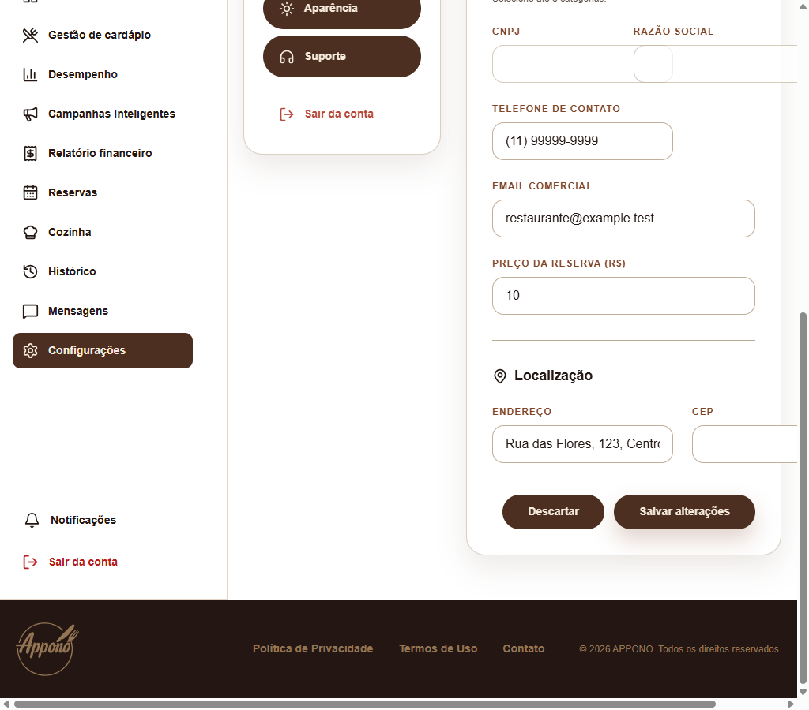
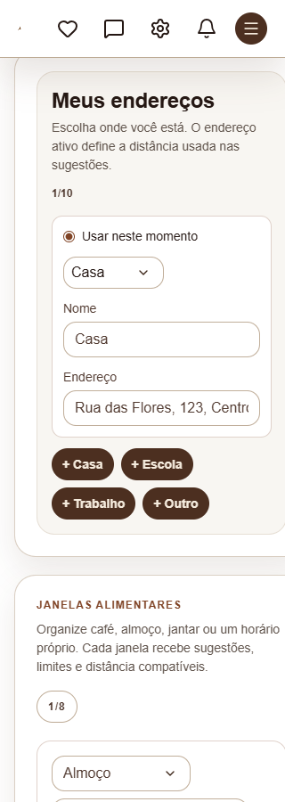
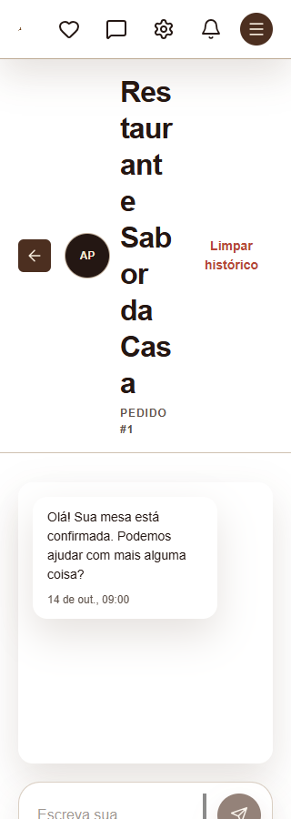
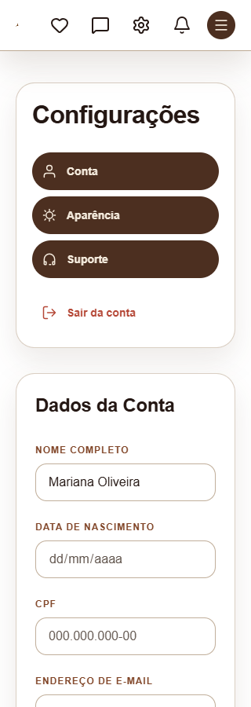
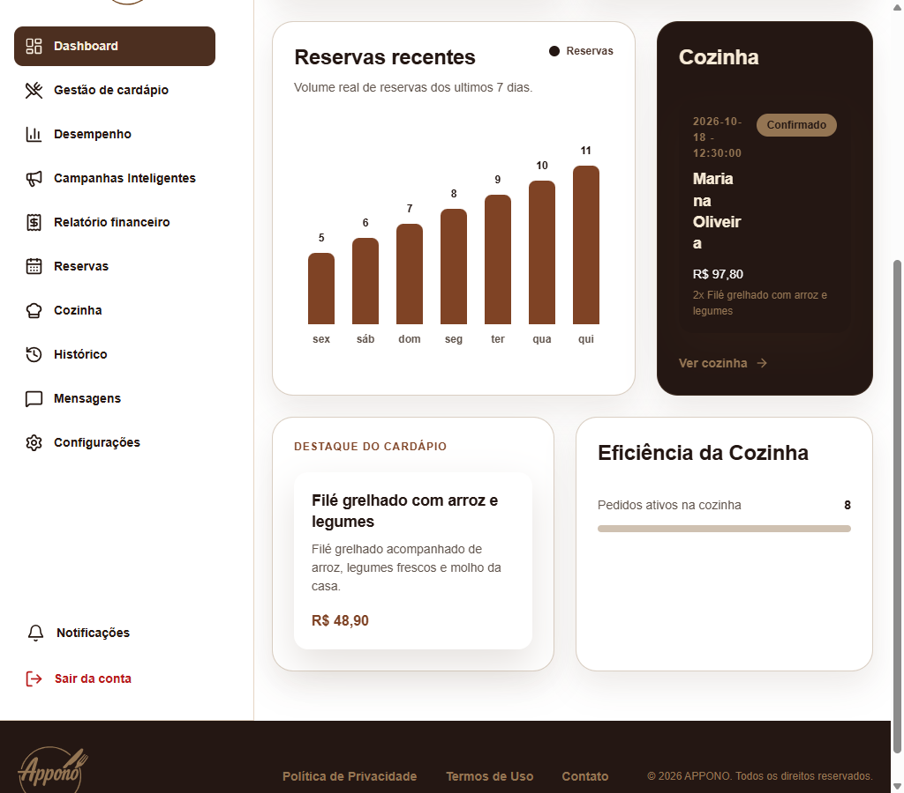
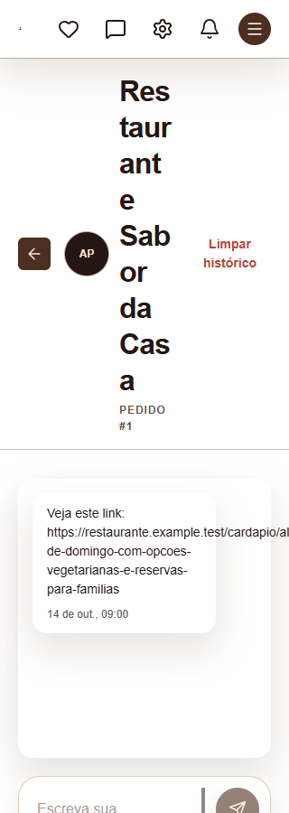
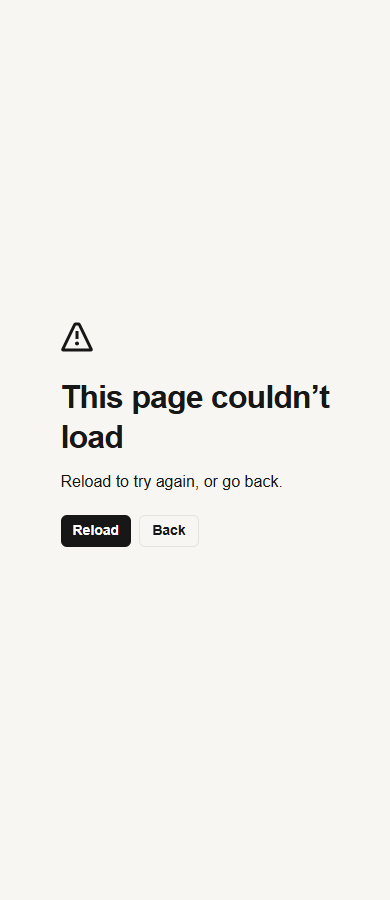

# Auditoria de responsividade — Appono

Revisão local de 15/10/2026. Foram percorridas **64 rotas de entrada**, incluindo redirecionamentos, nas áreas pública, cliente, restaurante e administração. Foram encontrados **seis problemas de responsividade** e **uma falha funcional adicional**.

## Problemas confirmados

| Prioridade | Local | Largura testada | O que acontece |
| --- | --- | --- | --- |
| Alta | Restaurante → Configurações → Dados cadastrais e Localização | 1024 e 1100 px | Os campos extrapolam o painel. Em 1024 px, a página alcança **1105 px**; CNPJ/Razão social se sobrepõem e o CEP sai da tela. |
| Alta | Cliente → Appono Rotina → Configurar → Endereços e Janelas alimentares | 320 px | Os blocos alcançam **347 px**, cortando a lateral direita e criando rolagem horizontal. Confirmado também na emulação de celular. |
| Média | Cliente → Mensagens → Conversa | 320 e 390 px | Nome do restaurante, avatar, botão de voltar e “Limpar histórico” disputam a mesma linha. Um nome comum vira uma coluna de fragmentos e ocupa grande parte da tela. |
| Média | Cabeçalho compartilhado da área do cliente | 320 px | O logo encolhe para **4 px de largura** na emulação de celular. Ao redimensionar o navegador com barra de rolagem, chega a 0 px. |
| Média | Restaurante → Dashboard → Cozinha | 1024 px | O cartão fica estreito com o menu lateral aberto. “Mariana Oliveira” e o horário se quebram em fragmentos, dificultando identificar o pedido. |
| Média | Cliente → Mensagens → Conteúdo de uma mensagem | 320 px | Um link sem espaços ultrapassa o balão e alarga a página para **359 px**. Reproduzido nos temas claro e escuro. |

### 1. Campos das configurações do restaurante

Rota: `/restaurante/configuracoes`. O redirecionamento de `/restaurante/configuracoes/notificacoes` também leva a esse painel.

Para reproduzir, abra os dados cadastrais em 1024 px e role até CNPJ/Razão social e Localização. A combinação do menu principal, menu de configurações e formulário em colunas deixa menos espaço do que os inputs exigem.

Referências: `frontend/components/restaurante/configuracoes/painel-configuracoes.jsx:74`, `:195`, `:253` e `:267`.

Direção do ajuste: permitir que labels e inputs encolham (`min-width: 0`, largura de 100%) e ativar as colunas conforme o espaço disponível no painel. No tema escuro, a regra existente de `min-width: 0` nos inputs já evita esse estouro em 1024 px; falta consistência com o tema claro.



### 2. Endereços e horários do Appono Rotina

Rota: `/cliente/rotina/configurar`, primeira etapa.

Em 320 px, os cards mantêm uma largura mínima maior que a disponível. O problema aparece com dados comuns, sem exigir nomes ou endereços excepcionalmente longos. Em 390 px, o estouro de página não foi observado.

Referências: `frontend/app/cliente/rotina/configurar/page.jsx:480`, `:486`, `:493` e `:501`.

Direção do ajuste: permitir a redução dos blocos e campos aninhados e reduzir o espaçamento interno nas menores larguras. A contraprova no tema escuro reduziu o estouro, mas ainda deixou conteúdo além da largura útil do navegador em 320 px.



### 3. Cabeçalho da conversa do cliente

Rota: `/cliente/mensagens/[conversationId]`.

Foi usado o nome fictício “Restaurante Sabor da Casa”. Em 320 px, o título se divide em muitos fragmentos; em 390 px, ainda ocupa várias linhas. Não há necessidade de rolagem horizontal para o layout estar inadequado.

Referências: `frontend/app/cliente/mensagens/[conversationId]/page.jsx:116`, `:126` e `:132`; `frontend/app/tipografia.css:149`.

O título tem a classe `text-base`, mas a regra global de `h1` aplica 32 px com `!important`. Isso aumenta a pressão sobre a linha que também contém avatar e ações.

Direção do ajuste: reorganizar as ações no celular, reservar espaço para o título e compatibilizar sua tipografia com esse cabeçalho.



[Captura da mesma conversa em 390 px](mobile-chat-390.png).

### 4. Logo do cabeçalho do cliente

Componente compartilhado por todas as páginas da área do cliente. Reproduzido em `/cliente/configuracoes`.

A imagem prevista para 44 px fica com apenas 4 px em um celular emulado de 320 px. Os cinco controles e seus espaçamentos consomem o espaço da marca. Em 360 e 390 px de emulação móvel, o logo voltou a 44 px.

Referências: `frontend/components/cliente/cliente-header.jsx:48`, `:61` e `:85`.

Direção do ajuste: reduzir a quantidade de ações simultâneas ou os espaçamentos no cabeçalho pequeno, preservando a largura da marca.



[Comparação em 390 px](mobile-cabecalho-390.png).

### 5. Cartão Cozinha no dashboard do restaurante

Rota: `/restaurante/dashboard`.

Em 1024 px, o menu lateral permanece aberto e o conteúdo passa para duas colunas. O cartão Cozinha fica estreito demais para o nome, data, horário e badge de status. A página cabe na tela, mas a leitura do pedido fica prejudicada.

Referências: `frontend/app/restaurante/dashboard/page.jsx:108`, `:134` e `:142`.

Direção do ajuste: empilhar os painéis até haver espaço suficiente no conteúdo, ou adaptar a organização interna do pedido com base na largura do cartão.



### 6. Link ultrapassa o balão da conversa

Rota: `/cliente/mensagens/[conversationId]`.

A mensagem de teste contém um endereço de cardápio fictício, com aproximadamente 100 caracteres. Em 320 px, o texto ultrapassa o balão e a largura do documento chega a 359 px. O mesmo comportamento foi observado no tema escuro.

Referência: `frontend/app/cliente/mensagens/[conversationId]/page.jsx:144`.

Direção do ajuste: permitir quebra de URLs e sequências sem espaços no conteúdo da mensagem, mantendo a largura do balão limitada ao contêiner.



## Falha funcional encontrada durante a revisão

Em `/restaurante/mensagens/[conversationId]`, carregar uma conversa com mensagem causa **`ReferenceError: dataHoraUI is not defined`**. A página mostra a tela de erro em vez da conversa, inclusive fora do celular. Isso bloqueou a avaliação do layout desse estado.

O componente usa `dataHoraUI` em `frontend/app/restaurante/mensagens/[conversationId]/page.jsx:137`, mas extrai apenas `ui` e `localeUI` do hook na linha 33. A conversa do cliente extrai esse formatador corretamente.



## Cobertura e método

- **7 rotas públicas**, **25 do cliente**, **26 do restaurante** e **6 administrativas**.
- Base: **320, 390, 768, 1024 e 1440 px**. Contraprovas incluíram 360, 1100 e 1280 px, emulação móvel e paisagem de 812 × 375 px.
- **443 registros de medição**, contando a passagem inicial, interações e contraprovas. São observações de layout, não 443 testes independentes com aprovação automática.
- Foram abertos menus, popups de notificações, seleção de perfil, etapas dos cadastros, etapas da rotina e agenda com reserva. Também foram examinadas conversas, cardápios, campanhas e uma linha de repasse financeiro com dados fictícios.
- Foram conferidos largura do documento, elementos fora da área visível, áreas de rolagem, sobreposições e erros de execução. Os problemas listados acima têm confirmação visual.
- A rolagem horizontal interna das ações da agenda está explícita no componente (`overflow-x-auto`). Ela foi registrada como comportamento atual, sem ser contada como estouro da página.

O site foi executado localmente em Chrome/Next.js. As respostas da API foram substituídas no navegador por dados fictícios para abrir os três perfis. A revisão corresponde ao código deste checkout. Login/OAuth real, checkout externo e todos os estados possíveis de dados de produção permanecem fora dessa validação visual. Nenhum arquivo da interface foi alterado.

A ausência de problema encontrado em uma rota significa apenas que não houve falha identificada nos estados e larguras inspecionados.

## Evidências

- [Relação das 64 rotas e destinos](cobertura.md).
- [Medições da passagem inicial, com rechecagens incorporadas](medicoes.json).
- [Menus, janelas, conversas e dados preenchidos](interacoes.json).
- [Contraprovas móveis e etapas dos formulários](revisao.json).
- [Contraprovas de tema e falha da conversa do restaurante](verificacao-final.json).
- [Contagem das observações](resumo.json).
- Automação: `reproduzir.mjs`, `cenarios.json`, `cenarios-complementares.json` e `cenarios-verificacao.json`.

Para repetir os cenários, a automação requer o frontend local na porta 3000 e uma instância isolada do Chrome com depuração local na porta 9222. Execute na raiz do repositório:

```powershell
node docs/auditoria-responsividade/reproduzir.mjs scenarios docs/auditoria-responsividade/cenarios.json
```
